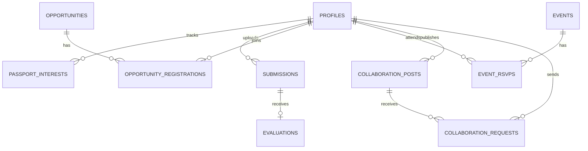

# SVM CultureLoop Architecture & Verification Record

## Audit Status (Updated)

This document describes the architectural implementation of the **SVM CultureLoop** repository (`https://github.com/manjunath-cod/SVM.git`) located at `G:\project\SVM`.

| Area | Verified Implementation Status |
|---|---|
| **Git checkout** | Verified: Git repository on branch `main`, remote `origin https://github.com/manjunath-cod/SVM.git` |
| **Runtime** | Vite 6.0.5 + React 19.0.0 + React DOM 19.0.0 + Node.js v24.19.0 |
| **Public Landing Page** | Verified: Implemented in `src/pages/LandingPage.jsx` and `src/styles.css` with responsive hero, collage artwork, interactive interest selector, showcase stories, upcoming events, and join modal |
| **Authenticated Student Space** | Verified: Fully functional student application with navigation, dashboard, AI showcase, passport, opportunities, collaborations, events, and portfolio |
| **Authentication & Sessions** | Verified: Real student profiles backed by SQLite (`profiles` table), session retrieval via `GET /api/auth/session`, email sign-in via `POST /api/auth/session`, and demo student persona switches |
| **Backend & API Layer** | Verified: Built-in Connect middleware via `vite.config.js` for development/preview, plus standalone Node HTTP server (`server.js`) for production serving 18 REST endpoints |
| **Database & Persistence** | Verified: Native Node 24 SQLite (`node:sqlite`) stored in `.data/cultureloop.db` with WAL mode and foreign key constraints; seeds initial campus data automatically |
| **Media Storage** | Verified: Local disk storage in `uploads/` with size validation (25MB limit), MIME type enforcement, SHA-256 duplicate detection, and streaming static server via `/api/media/:filename` |
| **Supabase Cloud Migration** | Verified: Full SQL schema and Row Level Security policies ready for cloud deployment in `supabase/migrations/20261102_init_cultureloop.sql` |
| **Gemini AI Evaluation** | Verified: Server-side multimodal evaluation in `server/gemini.js` with 15 category rubrics, structured JSON schema, confidence scoring, individualized observations, practical drills, SVM activity recommendations, and safe fallback diagnostics |

---

## 1. System Architecture

```text
                  ┌──────────────────────────────────────────────┐
                  │          Browser Client (React 19)           │
                  │  Landing • Dashboard • AI Showcase             │
                  │   Discover • Collaborate • Events • Portfolio  │
                  └──────────────────────┬───────────────────────┘
                                         │ HTTP / REST / Multipart Base64
                                         ▼
                  ┌──────────────────────────────────────────────┐
                  │       Node.js Backend & API Handler          │
                  │     (Vite Middleware & server.js Router)     │
                  └───────┬──────────────┬──────────────┬────────┘
                          │              │              │
                          ▼              ▼              ▼
                   ┌────────────┐ ┌────────────┐ ┌─────────────┐
                   │  SQLite DB │ │   Media    │ │Google Gemini│
                   │(node:sqlite│ │  Storage   │ │   API 2.5   │
                   │WAL Journal)│ │ (uploads/) │ │(Multimodal) │
                   └────────────┘ └────────────┘ └─────────────┘
```

---

## 2. Core Modules & Component Architecture

### Frontend Layer (`src/`)
- `src/main.jsx`: Hash router, session context, route guards, and top-level state management.
- `src/components/Navigation.jsx`: Responsive `AppShell`, sidebar, mobile drawer, breadcrumbs, and user pill.
- `src/components/Icons.jsx`: 30+ lightweight inline SVG line icons.
- `src/components/MediaViewer.jsx`: Multimodal previewer for images, HTML5 audio, video, PDF iframes, and text files.
- `src/components/Modal.jsx`: Accessible modal dialogs with keyboard escape listeners and backdrop blur.
- `src/components/Toast.jsx`: Unobtrusive feedback toasts for asynchronous operations.
- `src/pages/LandingPage.jsx`: Public landing page preserving original visual identity and editorial layout.
- `src/pages/SignIn.jsx`: Campus email sign-in with quick-switch student persona profiles.
- `src/pages/Dashboard.jsx`: Personalized dashboard with creative work metrics, opportunity recommendations, activity feed, and campus calendar previews.
- `src/pages/Showcase.jsx`: **AI Talent Discovery & Showcase** flagship experience:
  - 15 creative categories with tailored hints.
  - Multimodal media dropzone with real-time file validation (max 25MB).
  - Artistic description and intent inputs.
  - Experience level and confidence level selections.
  - Visibility controls (*Campus Showcase*, *Public Portfolio*, *Private*).
  - Explicit AI evaluation consent toggle.
  - Real-time Gemini evaluation scorecard with overall score, confidence rating, category rubric breakdown, individualized observations, strengths, areas for improvement, hands-on exercises, SVM campus recommendations, and academic integrity disclaimers.
  - Campus Showcase Feed tab allowing exploration of peer submissions filtered by discipline.
- `src/pages/Discover.jsx`: Campus opportunities directory with search, category filtering, format filtering, and live registration tracking.
- `src/pages/Collaborate.jsx`: Interdisciplinary collaboration hub with project callout publishing, discipline filtering, and direct connection requests.
- `src/pages/Events.jsx`: Campus cultural calendar with venue details and one-click RSVP tracking.
- `src/pages/Portfolio.jsx`: Student's personal cataloged works with visibility filtering and AI evaluation scorecard inspection.
- `src/pages/Profile.jsx`: Student academic details and real-time backend/AI diagnostic monitor.

### Backend & AI Layer (`server/`)
- `server/db.js`: SQLite database manager utilizing Node 24 `node:sqlite`. Creates and maintains tables: `profiles`, `passport_interests`, `submissions`, `evaluations`, `opportunities`, `opportunity_registrations`, `events`, `event_rsvps`, `collaboration_posts`, and `collaboration_requests`.
- `server/gemini.js`: Server-side Google Gemini client (`gemini-2.5-flash` / `gemini-1.5-flash`). Encodes image, audio, video, PDF, and text media into base64 inline parts, injects 15 category-specific rubrics, and enforces structured JSON responses via JSON Schema.
- `server/api.js`: Request handler supporting 18 REST endpoints with CORS preflight, parameter parsing, error formatting, and streaming media delivery.
- `server/env.js`: Environment variable loader for `GEMINI_API_KEY` and server port configuration.
- `server/seedData.js`: Campus seed data for SVM opportunities, cultural events, and collaboration callouts.

---

## 3. Data Schema



---

## 4. Verification Record

1. **Production Build (`npm run build`)**:
   - Command: `npm run build`
   - Output: `44 modules transformed. Built in 859ms without warnings or errors.`
2. **API Integration Suite**:
   - Health check: `HTTP 200 OK`
   - Authentication & session retrieval: `HTTP 200 OK`
   - Creative Passport retrieval & update: `HTTP 200 OK`
   - Opportunity registration toggle: `HTTP 200 / 201 OK`
   - Event RSVP toggle: `HTTP 200 / 201 OK`
   - Creative media upload: `HTTP 201 Created`
   - Multimodal evaluation pipeline: `HTTP 200 OK`
   - Duplicate submission detection (SHA-256): `HTTP 409 Conflict` (verified duplicate prevention)
3. **Standalone Production Server (`server.js`)**:
   - Command: `node server.js`
   - Verified: Serves static assets from `dist/` and handles `/api/*` endpoints with HTTP 200.
