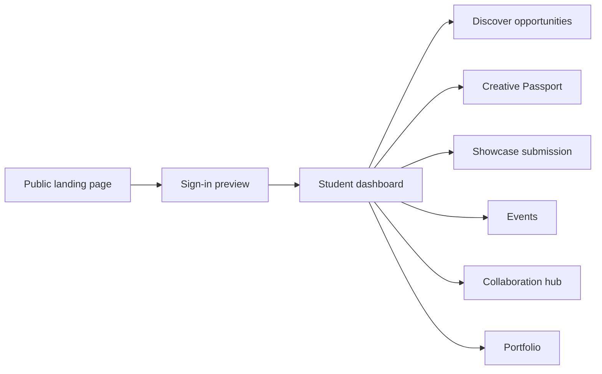
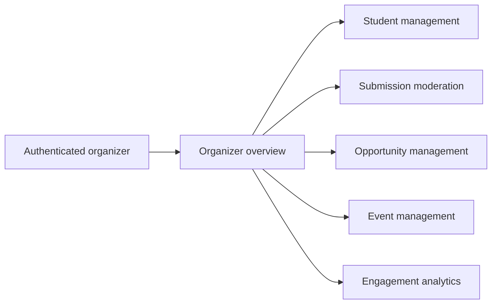
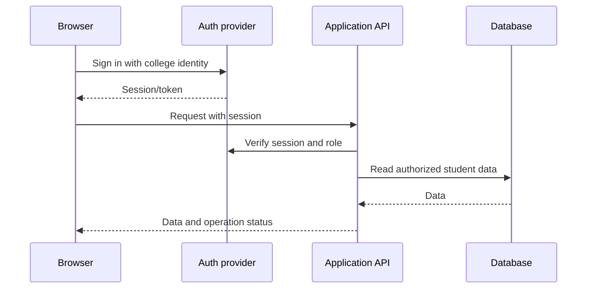
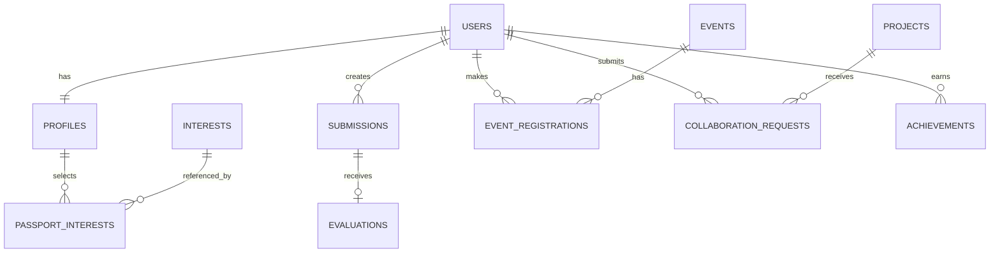
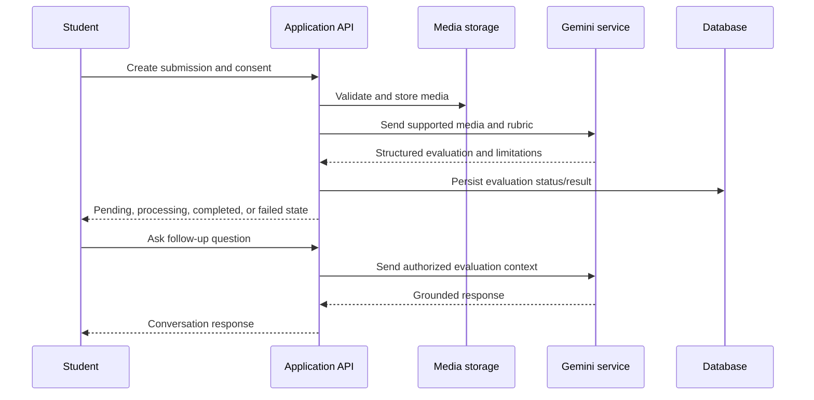

# SVM CultureLoop Architecture

## Audit status

This document describes the contents of the currently open workspace at `G:\project\SVM`.
It distinguishes verified implementation from frontend preview behavior and proposed
backend work.

| Area | Verified status |
|---|---|
| Git checkout | Not present in this workspace; `.git`, branch, remote, and commits are unavailable |
| Runtime | Vite 6 + React 19 + React DOM |
| Public landing page | Implemented in `src/main.jsx` and `src/styles.css` |
| Authenticated student UI | Implemented as a local frontend preview with hash routes |
| Authentication | Not connected; preview session uses `localStorage` |
| Backend/API | Not present |
| Supabase/database/storage | Not present |
| Gemini/AI evaluation | Not present |
| Automated tests/lint/type-check | No scripts or test suite configured |

The requested GitHub repository (`https://github.com/manjunath-cod/SVM.git`) could not
be verified from this workspace because it is not a Git checkout. No Git operation was
performed and no history was changed.

## 1. Product overview

CultureLoop is intended to help SVM students discover creative interests, find
collaborators, participate in cultural opportunities, share creative work, and build a
portfolio. Participation should not require prior experience.

Guiding statement: **Discover Your Talent. Find Your People. Create Together.**

## 2. Current technology stack

- Vite 6 (`vite`)
- React 19 (`react`, `react-dom`)
- JavaScript/JSX; no TypeScript compiler
- CSS in `src/styles.css`
- Google Fonts loaded by CSS (`Manrope`, `DM Mono`)
- Browser `localStorage` for the preview session
- No router package; hash changes are handled in `src/main.jsx`

Commands:

```powershell
npm install
npm run dev
npm run build
npm run preview
```

## 3. Repository structure

```text
SVM/
├── index.html                 # Vite HTML entry
├── package.json               # scripts and dependencies
├── package-lock.json          # npm lockfile
├── src/
│   ├── main.jsx               # landing page, auth preview, app shell and pages
│   └── styles.css             # public and authenticated UI styles
├── dist/                      # generated build output
├── design-system/             # generated UI/UX design-system artifact
└── .github/prompts/           # prompt and design tooling assets
```

There are no verified `api/`, `server/`, `supabase/`, `migrations/`, `functions/`,
`tests/`, or environment files in the workspace.

## 4. Routes and user journeys

The current frontend uses hash routes:

| Route | Access | Current behavior |
|---|---|---|
| `#top` or empty hash | Public | Existing CultureLoop landing page |
| `#signin` | Public | Preview sign-in form |
| `#dashboard` | Preview session | Student dashboard |
| `#discover-app` | Preview session | Searchable local opportunity list |
| `#passport` | Preview session | Local Creative Passport editor |
| `#showcase-app` | Preview session | Local showcase form and file selection |
| `#collaborate` | Preview session | Backend-not-connected empty state |
| `#events-app` | Preview session | Backend-not-connected empty state |
| `#portfolio` | Preview session | Backend-not-connected empty state |
| `#profile` | Preview session | Backend-not-connected empty state |

The preview session is created after submitting any valid email at `#signin` and stored
as `cultureloop-session=preview`. This is not authentication and must be replaced before
handling real student data.

### Student journey



### Intended organizer journey

Organizer pages are not implemented. The intended flow is:



## 5. Component architecture

All current components are colocated in `src/main.jsx`:

- `LandingPage`: preserves the original public experience.
- `Logo`, `Icon`, `AppIcon`: lightweight SVG icon and branding primitives.
- `JoinModal`: public early-access form; currently local-only.
- `SignIn`: preview sign-in screen.
- `AppShell`: authenticated sidebar, header, profile and sign-out controls.
- `PageHeader`: shared authenticated page heading.
- `Dashboard`: personalized preview dashboard.
- `Discover`: local search and filter controls.
- `Passport`: local interest and introduction form.
- `Showcase`: local file selection and submission form.
- `SimpleCollection`: honest empty states for unavailable backend surfaces.
- `AuthenticatedApp` and `App`: hash routing and preview session state.

`src/styles.css` contains shared design tokens, public landing styles, authenticated
layout styles, responsive breakpoints, focus states, and reduced-motion behavior.

## 6. Design system

The verified visual direction is minimal Swiss-style UI with generous whitespace:

- Primary purple: `#6C4AE4`
- Secondary lavender surface: `#F0EDFA`
- Deep navy: `#19182E`
- Soft background: `#FBFAFC` / authenticated `#F8F7FC`
- Main text: `#19182E`
- Muted text: `#77758A`
- Border: `#E7E4EF`
- Typography: Manrope with DM Mono metadata and Georgia editorial emphasis
- Icons: inline line SVGs, not emoji-based structural icons
- Accessibility: visible focus rings and `prefers-reduced-motion` support

The UI/UX Pro Max recommendation used for the authenticated space was Minimalism &
Swiss Style with a restrained purple community palette and responsive dashboard layout.

## 7. Data, API, authentication and authorization

No backend contracts, API endpoints, Supabase project configuration, migrations,
storage buckets, server actions, or role claims were found.

The following are therefore **not implemented**:

- Student profile persistence
- Creative Passport persistence
- Real opportunities or matching
- Media upload to storage
- AI evaluation or follow-up conversation
- Event registration
- Collaboration requests
- Portfolio approval/privacy
- Achievements
- Notifications
- Organizer authorization and moderation

The frontend must not claim these operations succeeded until an API response confirms
the operation. The current unavailable surfaces intentionally explain that backend
integration is missing.

### Target authentication flow



Frontend route guards are not a security boundary. The future API must verify session,
role, ownership, upload permissions, moderation permissions, and privacy settings on
every protected operation.

## 8. Proposed data model

The following is a target model, not an existing schema:



Suggested entities: `profiles`, `interests`, `passport_interests`, `opportunities`,
`submissions`, `submission_assets`, `evaluations`, `evaluation_messages`, `events`,
`event_registrations`, `projects`, `project_roles`, `collaboration_requests`,
`achievements`, `user_achievements`, and `notifications`.

## 9. AI evaluation design

No Gemini client, server key, evaluation endpoint, or AI schema exists today.
The browser must never receive a provider secret or call Gemini directly.

Target workflow:



Evaluation results must be tied to the stored submission, consent, model response,
confidence/limitations, and visibility policy. Scores should be omitted when the
backend marks them unreliable.

## 10. Security and privacy requirements

- Keep provider secrets server-side.
- Verify authenticated identity and role server-side.
- Enforce submission ownership and portfolio visibility server-side.
- Validate MIME type, size, extension, and content before storage/AI processing.
- Keep private evaluations out of public showcase responses.
- Use explicit consent for AI processing.
- Rate-limit uploads and AI follow-up requests.
- Audit organizer moderation and contribution verification actions.
- Do not treat hidden frontend controls as authorization.

## 11. Implementation roadmap

### Implemented and verified

- Existing public landing page and join modal.
- Responsive authenticated preview shell.
- Hash-based navigation.
- Dashboard, Discover, Passport, Showcase preview screens.
- Honest empty states for backend-dependent screens.
- Local preview sign-in/sign-out behavior.
- Responsive styling, visible focus states, and reduced-motion CSS.

### Partially implemented

- Sign-in is only a local preview.
- Dashboard data and opportunities are static local constants.
- Passport edits are in-memory only.
- Showcase selects a browser file but does not upload or persist it.
- Search is local and only applies to the preview opportunity list.

### Blocked by backend/configuration

- Supabase authentication and authorization.
- Database and migrations.
- Storage and media processing.
- Gemini evaluation and grounded conversation.
- Real events, registrations, opportunities, projects, portfolios, achievements,
  notifications, and organizer tools.

### Next engineering steps

1. Attach the workspace to the intended Git repository and verify the remote.
2. Choose the backend contract and configure Supabase project/environment variables.
3. Add database migrations and row-level security policies.
4. Add server-side API routes for profiles, passport, opportunities, submissions,
   events, projects, portfolios, notifications, and organizer actions.
5. Add storage upload validation and asynchronous evaluation jobs.
6. Replace preview constants/localStorage with authenticated API data and loading/error
   states.
7. Add organizer routes with server-enforced role authorization.
8. Add automated component, integration, and accessibility tests.

## 12. Verification record

The following checks were run against the current workspace:

- `npm run build`: passed.
- `Invoke-WebRequest http://127.0.0.1:5173/`: returned HTTP 200.
- Browser verification: `#signin` rendered, local sign-in navigated to `#dashboard`,
  and the dashboard rendered its navigation and content.
- Git audit commands: unavailable because the workspace is not a Git repository.
- Lint/type-check/tests: unavailable because no corresponding npm scripts or suites
  are defined.
